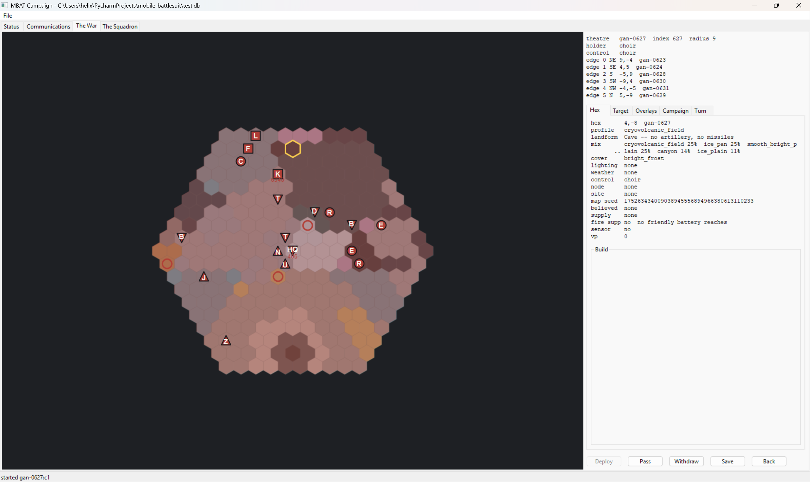
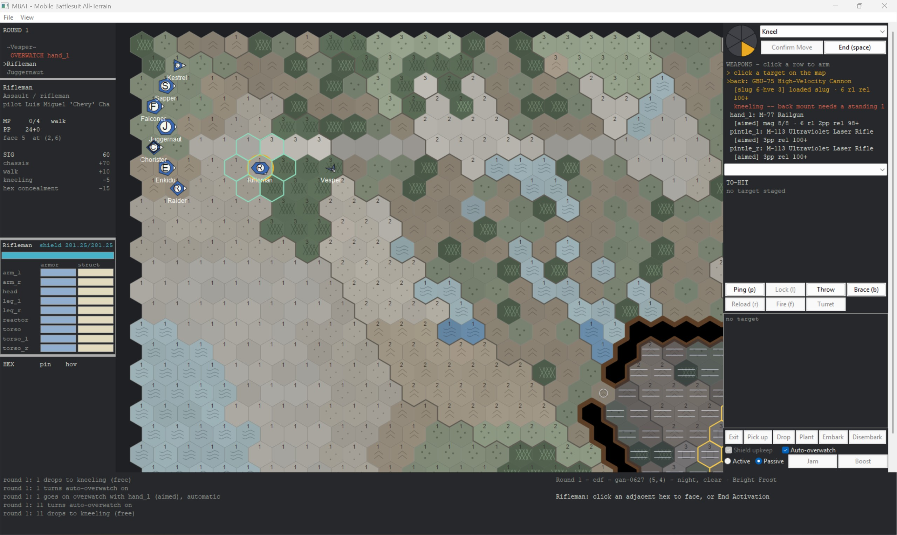
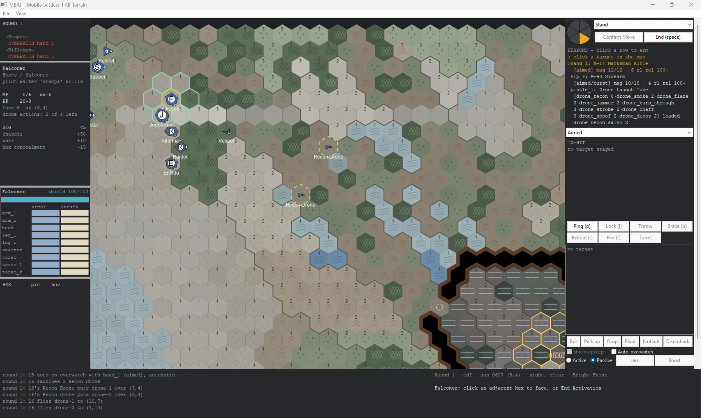
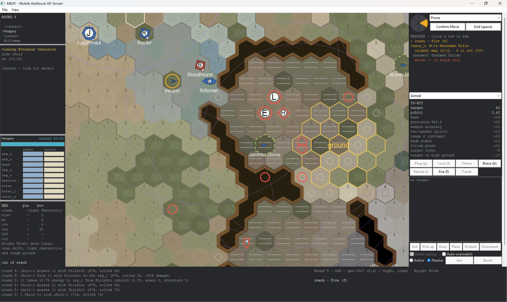
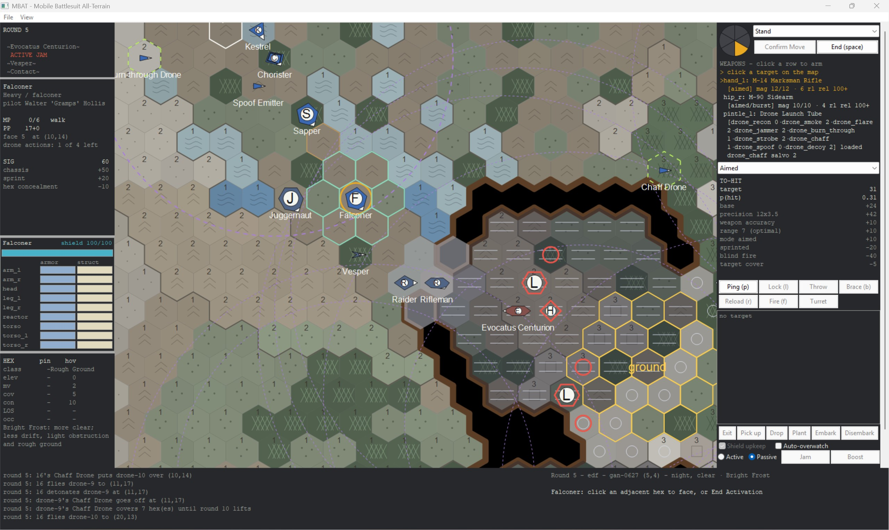
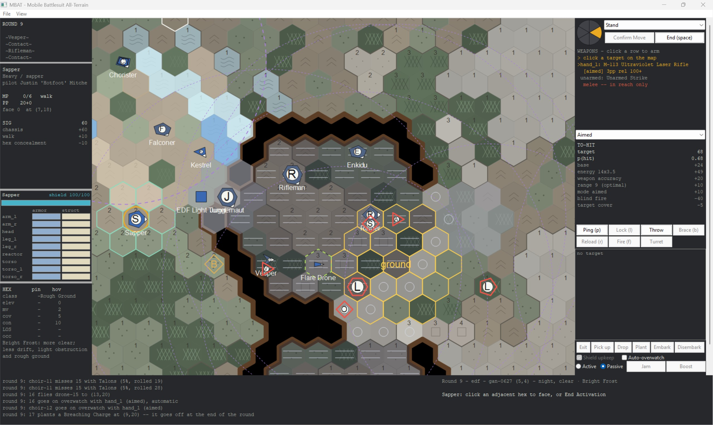
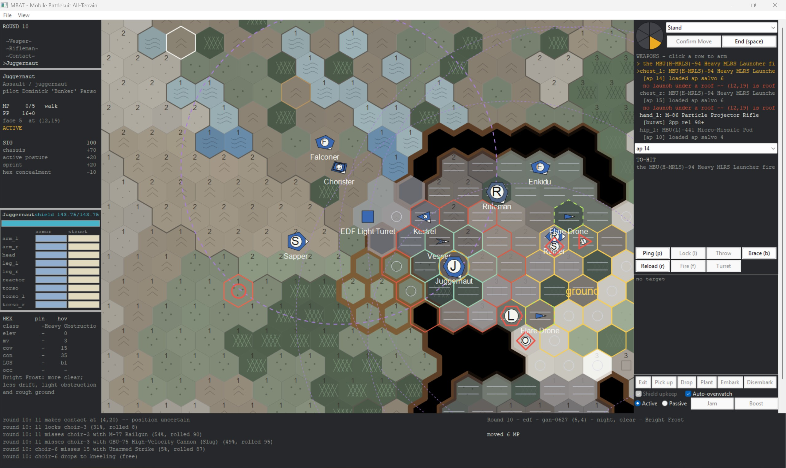

Okay, so this is going to be a long post. But I have pictures, so hopefully it will be worth it. Most of this is going to be about combat, with some of the Role information, because it showcases some things that are really important, like the difference between Drone Controller, Combat Engineer, and Combat Frames.

### The Mission

First mission of the new campaign on Ganymede. The EDF established a Beachhead in the lower-right quadrant of the cell map (the thing above this) and I got several mission possibilities. One of the most important things to do starting off is secure your HQ, which is always the first location a side takes when they attack a new territory. This prevents the enemy from directly attacking your HQ because if they win, then your attack is repulsed.

So I found a capture mission that would allow us to protect the HQ. The intel sweep hadn't run yet, so it was going to be unknown, but this particular territory was out of range from the nearest surveillance center anyway, so this whole battle was going to have to be done with local recon and signals intelligence missions if I wanted to have any intel.

### The Drop

As you'll notice, there's no 'art'. Everything is a vector-drawn image. The dark areas are heavy cover, lighter areas are lighter cover. The gold hexes you see in the southeast corner of the image are actually in a cave, and that's my objective. Generally speaking, the closer something is to a neutral beige color, the more exposed you are.

I deployed in the Northwest of the randomly generated map, and my capture location was placed in the center. South of me was a large open area with almost no cover, plus ice slush and water areas that would slow my Frames down. The Northwest approach offered decent cover, but knowing that the objective was in a cave presented some problems.

Firstly, artillery and missiles don't penetrate cave roofs, and with a single opening on the west side, it meant I was going to be exposed going in. That's alright, because that's the Rifleman's job.

| **Rifleman** | Combat |
|---|---|
| **Class** | Assault |
| **Armament** | GBU-75 High-Velocity Cannon (Back Mounted Direct Fire 150mm Rifled Cannon) 2x M-113 Ultraviolet Laser Rifle (Pintle Mounted - 360 degree fire arc) M-77 Railgun (carried in the hands) |
| **Shields** | Frontline Shield Emitter III |
| **Armor** | Heavy Plate III |

The Rifleman is the heaviest EDF Frame available during the campaign on Ganymede. It's built to step into fire and hold a position, and the cave chokepoint would be absolutely perfect for it.

### Close to Contact

However, the lack of missiles and artillery meant this was going to be a knife fight. It was also a nighttime drop, which meant `CONCEALMENT` would be high, especially inside the cave, and for the enemy's stealth units, it meant I'd be relying on sensors more than eyes. So I switched over to the Falconer.

| **Falconer** | Drone Controller |
|---|---|
| **Class** | Heavy |
| **Armament** | M-14 Marksman Rifle (carried in the hands) 2x Drone Launch Tubes M-90 Combat Pistol (Worn on the Right Hip) |
| **Shields** | Shield Generator III |
| **Armor** | Base Values for a Heavy Frame |
| **Special Equipment** | 2x Heavy Drone Bays Full complement of 40 Drones of assorted types |

The Falconer's ability to deploy drones of multiple types is invaluable here. I started off by deploying two recon drones that would help find the enemy, and continued to move the rest of the force southeast to the cave complex that housed the objective, which the enemy was probably going to be occupying.

When we got there, it was what I expected. Both recon drones got shot down, but it gave me enough information to know: only the Rifleman could stand in that cave mouth and survive. But it'd still need some extra help, so I deployed another two drones: Chaff drones.

Chaff drones explode in a shower of chaff when they're triggered, playing hell with the enemy's sensors and their ability to shoot. But, like most things in MBAT, they don't discriminate; chaff affects you just as much as it does the enemy, and the malus is per-hex, which means that dumping chaff on the enemy protects *them* from *you*, not the other way around.

I moved the Raider down to support the Rifleman and detonated one of my Chaff drones over the two of them. The Raider would have a hard time with accuracy, but the Raider mounts **Chainguns**, which can be used to `SUPPRESS` a hex and the hexes surrounding it. The Raider was exactly what the Rifleman needed: Suppression keeps the enemy in place and drops them prone to avoid fire, and the Rifleman lacked the close combat capabilities some of the other Frames have.

### Breach, Breach, Breach

While the Rifleman and Raider worked on keeping the enemy busy in the cave, I moved my Sapper to the southern wall. I could see two patches of heavy cover inside the cave, and I wanted to take advantage of those with my other units.

| **Sapper** | Combat Engineer |
|---|---|
| **Class** | Heavy |
| **Armament** | M-113 Ultraviolet Laser Rifle (carried in the hands)|
| **Shields** | Shield Generator II |
| **Armor** | Base Values for a Heavy Frame |
| **Special Equipment** | 2x Berm Deployables 1x Light Suppressor Turret Deployable 1x Breaching Charge |

The Sapper is the Heavy Combat Engineer Frame, meant to make holes, create cover, and deploy friendly turrets in support of the rest of the squad. In this case, I deployed my turret on the way down and then stuck the Breaching Charge right next to the wall that I wanted gone. The Breaching Charge destroys the hex it's planted on, plus the six surrounding hexes just like an HE artillery shell.

Only issue is, the Breaching Charge CAN detonate on friendlies and on the Sapper itself if it doesn't move out of the way. (Pro tip: Plant takes your main action, not your move action, so move to the location in one round, and in the next round, plant and then move away. Don't plant at the end of the turn after you've moved.)

I took some friendly fire damage on the Vesper, but I also damaged an enemy Auxilia at the same time. The Juggernaut (an assault missile boat) pushed into the cave, where its missiles would be useless, but it does have pintle-mounted Railguns to support itself in combat.

Post-battle analysis would conclude that this was, indeed, a knife fight. Most engagements took place within 3 hexes, or within 75 meters. Both sides had a difficult time locking, and it was only the Kestrel's deployment of Flare drones inside the cave that really allowed the EDF forces to acquire targets while the Choir tried to fight from the darkness.

### Closing Thoughts

This is a good example of the kind of battles MBAT offers, and the kinds of tactical flexibility it relies on. You'll find yourself, at times, without access to artillery, air support, or missiles. You'll find yourself fighting in the dark, in a Jovian eclipse, and in the middle of a heavy icefall. The enemy's heavy ECM (the purple circles on the images) makes targeting extremely difficult without an ECCM Frame, and at this point in the game I didn't have access to one. It also showcases one important thing about MBAT: I deployed 9 Frames for this mission, against an enemy force of **25**. You are always outnumbered. In this case, the conditions worked against both of us, but on a clear day, the battle result might've been very different.