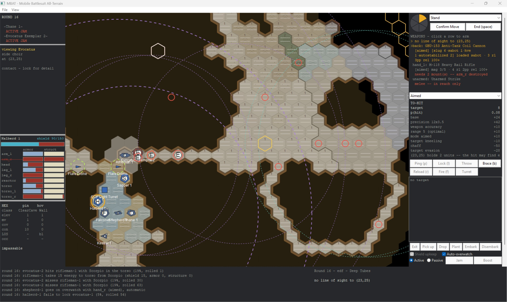

One of the things that makes MBAT unique is not just where you can fight, but who.

Officially, we're in the P4.6C1 branch - working on building up space-to-ground weaponry, from both fighters and orbital craft. As an aside to that, I've been going over two of the features that I think make MBAT unique:

* Special units: Much like the real military, there are unique military formations in the game that do different things, change how battles are fought, or even have their own technology and roles.
* Elements, or how the enemy is put together.

### Elite Units

First, we'll stop off at special units. I recently put an elite enemy formation into the game called 'The Returned'. These are elite enemy pilots that have served (and survived) their initial length of service, completed it honorably, and then were called back to fight in the invasion of Earth. Whereas most of the rest of the enemy force uses things like camouflage, The Returned paint their carapaces jet black, and each of them carries a Heraldic Shield and an Evocati Solitaire, an extremely capable one-handed melee weapon. They also mount a multitude of weaponry meant to be fired as they're closing, and some even while they're in melee combat.

They are, without a doubt, the most elite formation inside the Choir that the player can encounter during the first part of the game. But what makes them interesting is that they completely change how the enemy wants to fight.

Normally, the Choir assault units close and pin down the heavy damage dealers or try to take out the Command Frame. This presents something of a problem for other Choir units, because a unit that's in melee combat with another unit can't fire without risking hitting a friendly, and so they don't.

Not so for The Returned. Given the decades of experience they have fighting together, the Evocatus Centurion mounts a special command uplink. When an Evocati (the EDF codename for The Returned) is in melee combat, as long as their `TACNET` is up, the Evocati **never** hit the friendly unit when firing into melee. That means instead of trying to hang back and fire at range, the Evocati prefer to close with their specialist assault suits... while firing from attached tank and APC resources.

They specialize in shock infantry tactics, and especially prefer to fight in enclosed spaces, like aboard ships and inside caves.

### Elite Units and the Strategic Layer

Elite units don't just pop up somewhere, and even in locations where they're present, you don't fight them all the time. Elite units are based somewhere and redeploy around the map as the enemy commanders need reinforcements; but they also conduct more attacks and start more war campaigns against the opposing side than normal units do. But there are definitely locations that they **prefer**. Fighting The Returned during a Jovian eclipse across open ground is difficult, but doable. Fighting The Returned in a cave network that you have to clear chamber by chamber where their assault units tie your Frames up while their firing line continues to fire - that's another battle entirely.

How the strategic layer works with these units and some of the things we're building in P4 is a large part of P5, our next large feature phase, which will probably begin in mid-November.

### The Element

The key with fighting ANY unit in MBAT is that they're not generated alone. There are different types of elements in the game. The most basic is the Rifle Squad. Fairly generic, with some balanced ability between scouting and firepower, the Rifle Squad is the jack-of-all-trades, master of none. An Evocati can be selected to take part in the squad, but that's not the same as facing the Evocati element itself.

In any element, enemy selection breaks down to role OR script:

```json
    {
      "id": "rifle_base",
      "kind": "rifle",
      "name": "Rifle element",
      "members": [
        "commander",
        "bodyguard",
        "tracker",
        "line_veteran",
        "assault_veteran",
        "lineman",
        "assaulter",
        "lineman",
        "assaulter",
        "tracker",
        "screen",
        "gunner"
      ],
      "weight": 4,
      "vehicle": "fire_support",
      "vehicle_bv": 18505
    },
```

When a new mission is created in the war, it rolls for how many and which elements are present in that mission and, if elite enemies are present and you have enough intel to know about it, warns you.

Each one of these (in this case - you can also specify units in an element by their id, but that's only done in the elite formation) rolls a weighted die at the beginning of a mission to see which design actually fits that role. There are also multiple elements per mission that interact with each other on the battlefield.

So you might go into one battle facing a Rifle element, and in another battle face a Rifle Shock element, which carries much heavier firepower and some different capabilities, or a Headhunter element, which is... annoying.

What does this look like in practice?



The hexagonal 'E's here are Evocati heavy suits - all of them heavy assault suits. The three red circles to the right of the image are Evocati fire support units that have drawn a bead on the Rifleman and are in the process of absolutely wrecking that Frame. While the Evocatus and Evocatus Exemplar pin it down in melee, it's also getting shot at by a tank.

That's how The Returned fight, and that's what makes them so dangerous. They block the chokepoint, tie you up in melee, and support their front line with long-range precision fire.

### Closing Thoughts

This is one of the things I like most about MBAT. Special units in the real military have their own tactics and techniques. Yes, they're all 'infantry', so to speak, but they operate differently and they have different capabilities in different environments that can make them more or less effective. Put The Returned in a dark cave and they can stop your advance cold; put that same unit in a daytime advance across clear ground and they're much less effective, but still several notches above what the 'average' rifle element can do.