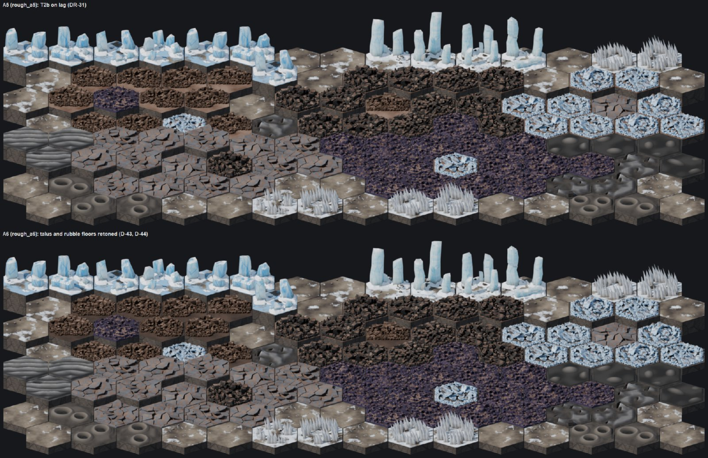

Musings on the importance of terrain and how to have a terrain system that is both flexible and yet visually interesting enough to prevent players from getting bored.

### Good Enough

A lot of times my development strategy can be defined as, 'good enough for now'. I wrote a terrain system back in the very early stages of the game with just a few terrain types:

* `Clear`: Does what it says on the tin. It's clear.
* `Light Obstruction`: Are you sensing a pattern here?
* `Heavy Obstruction`: Hello, Captain Obvious.
* `Drift`: Similar movement to clear, but provides cover and concealment.
* `Rough`: Less movement, more cover than other terrain types.
* `Impassable`: Not quite obvious, this is what 'cave walls' are made of.
* `Soft Hazard`: Slows down movement a little, provides no cover.
* `Liquid`: Right now the game doesn't measure depth, but liquid costs a lot to move through and doesn't provide any cover. River crossings are pretty much the worst thing ever for real-world infantry.

What you can see from this is that they aren't actually terrain types. None of those say what the ground *is*, they say how it affects *movement*, which is fundamentally what *terrain* is, but doesn't represent the variety of terrain you actually see with your eyes. Climbing a scree rockfall on the side of a mountain is treacherous, but so is navigating an ejecta field from a munition. Movement-wise, in-game, they're the same. Visually, I want them to be different.

I tend to do 'other things' once the design work is done and I'm waiting on the implementation session to finish. I've spent the last week thinking about what terrain means in the game beyond how it affects movement and how I want to represent it.

### A Visual Cue

This is subject to change, but this image represents how I think about terrain. What you see here are hexes of only a few different terrain types. There are a few patches of `Clear`, but most of this terrain is `Rough` and `Drift` with some `Heavy Obstruction` mixed in at the very top and bottom of the image (the ice columns and the blade-like ice hexes at the bottom).

Functionally, in-game, a Penitentes hex (the ice blades) and the Ice Column hex (the ice columns) are the same class of terrain: `Heavy Obstruction`. Visually, I think it's better to represent the idea that you're fighting on **Ganymede** by making the terrain something that doesn't look Earth-like at all. Game interprets it the same way, player doesn't get bored.

### Band of Brothers

This works because of how terrain generation actually works, in-game. Firstly, I took an actual high-res photo of Ganymede (thank you, NASA!) and overlaid it on a spherical surface kinda-sorta about the actual size of Ganymede.

Ganymede has two defining underlayment types: a bright frost, thought to be areas where the ice has pushed to the surface from the subsurface ocean, and dark lag, places where dirt and other material has built up on the surface. We represent that in-game in a Cell, which is a hexagonal and pentagonal subdivision of the spherical surface of Ganymede. Each cell is assigned either a frost or a lag underlayment.

Then, inside each cell, there's a calculation that runs that determines what the overarching terrain features are. So a lag cell might have windswept dunes (there is wind on Ganymede, actually), and a frost cell might have cryovolcanic tunnels, or ice plains.

Inside a cell, there is **another** hexagonal map, this one called the Theater map, which is where you actually plan missions and capture territory. Each hex has its own terrain features, and the first time a mission runs on a Theater hex, a map is generated from those features.

Terrain - what you see on the above image - is chosen at that time and placed in bands with weights, which means that the terrain types are related and tend to cluster together with a small chance for a random draw of a different terrain type.

The key is that the terrain type is chosen **per-band**, which means that each map could represent multiple different terrain types. You might have a band of Ice Columns representing `Heavy Obstruction` terrain, while you have a large area of Broken Crust representing `Rough` terrain on the map. And in other bands on the same map, you might have Penitentes (the ice blades) and Talus and Scree representing the same two terrain types, just with a different visual cue.

So the process goes:

Ganymede Surface -> Cell -> Theater -> Theater Hex -> Map

Each one reads from the level before it to inform what terrain it should actually have on it, the type, and the frequency.

### Terrain Changes, Maps Don't

In the Marine Corps, when you're in a place for a while, you learn the local area. You learn the spots to watch out for, you learn the spots that are safe... because you're there a lot. It's a physical place. One of my critiques of games with random map generation is that they generate a new map every time.

In MBAT's case, you might fight in the same hex on multiple mission types three or four times.

The map stays the same.

When the map is generated, we store the seed on the hex coordinates in the database, and then store a delta after the mission ends with any changes from the seed.

So if you call in an orbital railcannon strike and create a crater in the middle of the map? That crater will **always** be there. Destroy a tank (destroyed vehicles form LOS-blocking terrain and an obstacle) and the wreck is **always** there. It becomes part of your campaign and your experience on that map.

There are some exceptions, of course - mostly when a building changes. If a map's airfield is destroyed and an arcology is built in its place, the map won't have an airfield any longer. But I think that's pretty self-explanatory.

### Closing Thoughts

After a week and multiple failed experiments, I'm pretty happy with where we're at. I've ideated about a hundred different types of terrain across multiple planets, each one falling into the categories above. But I genuinely hope that when people play on Mars, they FEEL like they're on Mars. The only terrain type I've actually finished at this point is `Rough`, whereas the others are still in the ideation phase.