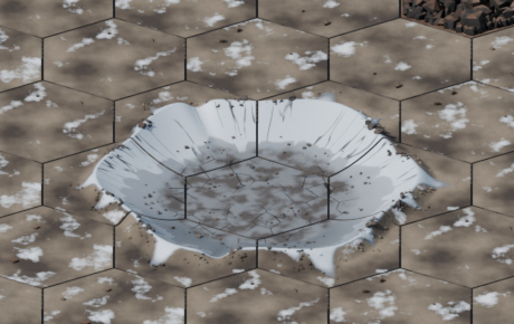

A few days ago Claude decided to give a time estimate of how long a minor build takes, and I thought I'd put it to the test. Turns out, Claude's off a little bit. News at 11. However: P4.6 is moving into the testing phase now.

### Phase 4 In a Nutshell

P4 on the Roadmap as a summary:

* P4S0: Pilot Skills
    * I broke up the original 3 skills into 9, allowing pilots to specialize more. Also included fixes for Quirk purchasing.
* P4.1: Fixes and Driver Updates (AI updates primarily)
    * Mostly squad-level AI behavior changes; dialing up the enemy's aggression with The Returned.
* P4.2: Builder Updates
    * MBAT contains an internal content authoring toolset that allows me to easily author Frames, Static emplacements, Subsystems, etc. This update fixed a bunch of QOL things in the builder and focused on screen real estate plus usability.
* P4.3: The Choir
    * Role add for the enemy; I further separated the enemy AI out from 6 roles and AI drivers to ~15, added Master-class enemy units, got the bubble shields working, and a whole lot of squad-level AI updates.
* P4.4: Vehicles and Air
    * This is where the first vehicles and airframes actually became objects that were in-game and could do things. Went through a lot of lower-level design for this one, because it's important to get it right. Also a *very* long discussion on orbital mechanics. The Anti-Armor role went in.
* P4.5: Deployables
    * Can you throw it, shoot it or launch it? It went here. Combat Engineers and Drone Controllers went into the game, drones became movable, commandable objects that did stuff, static deployable turrets came online, and defilade and the very first destructible terrain happened.
* P4.6: Fire Support (WE ARE HERE)
    * The world **outside** the battlefield started to affect the tactical map for the first time. Orbital fire support became callable, Airstrikes sport multiple munition bays, and off-grid artillery is now putting shots on target. The Air Defense Frame came online and the Choir's first purpose-built support armor (the Testudo) was deployed. The first surface-to-orbit interceptor missiles fired. The first Choir Hammers landed.
* P4.7: SAR and CASEVAC (FUTURE)
    * New missions around CSAR (Combat Search and Rescue) and CASEVAC (casualty evacuation) become available to play. The Medic/Recovery Frames go in. The Choir Biologis role goes in. The Choir Detention Camps become active nodes on the campaign map. Squadron members gain the 'MIA' tag in addition to 'WIA' and 'KIA' and rescues are possible.
* P4.8: Morale (FUTURE)
    * Right now no real morale system takes place. Units can be pinned or suppressed by fire, but that's it. This will let units break and run, the Headhunter roles mean something, and Decapitation missions go live and mean something.

In parallel, I've been working on a new art system that should update us to an isometric view with sprite-based terrain.

The result of an orbital strike on a ground target. This crater persists indefinitely; it almost always destroys every suit it lands on, friendly or enemy. Don't be there when it lands.

### P4.6 Testing Methodology

Because each 'minor' phase is adding significant changes to the game, including driver changes and changes to how cover works, things like orbital bombardment, I tend to spend significant time in more ambitious phases.

In P4.5 we spent nearly 10 days, with tests being done every few builds and two major tests written (missions that field a wide array of units and are meant to be played by both me and Claude through a headless harness that I have set up), plus playing through the actual campaign as normal. After a phase 'completes', I still play through on that version of the code while the next one is building - finding what I do and don't like, and adding that to the Queued Work epic for the next phase.

In this case, because we're significantly changing the firepower available to both sides, we're going to spend significant time here. At present, all major systems on the roadmap for P4.6 have been authored, tested, then adversarially tested, THEN code reviewed, but we still have about 25 known defects and a substantial amount of queued work to do before we can call P4.6 code-complete. Given that 4.6 is the biggest phase released so far after the War update, a week or more spent here is probably in order.

As that's happening, I do two things. Number one, I play through the authored missions and the game at large to test the systems. Airfields don't always let you launch airstrikes, for example, and orbital platforms aren't always available. We checked that that's true via unit testing, but there's no testing like **play testing**. Too many people working with AI don't play their games to see what works and what's fun.

Secondly, I use the agentic harness to have Claude play through a number of missions as well. Interestingly, the AI has a completely different playstyle. Claude's a bit of a turtle, to be honest. We each try to use our assets organically, though, looking for bugs and issues with play. Claude can, as you might imagine, play through missions a lot faster than I can.

### Current Timeline

So far, P4.6 coding has taken 7.4 days and around 36 sessions. We still have a large number of to-do tasks and playtesting to run. With Halloween coming up I expect I'll wrap up most coding issues by Monday. I've already played through the Air Defense intercept mission a few times and it's working as advertised (Air Defense Frames and Armor can intercept some orbital strikes, and can intercept airframes and missiles when they detect the strike). I expect another 3 days in coding then a few full campaigns on Ganymede to be played through before we are ready to move to P4.7, which will add the Medic Frame and the CSAR missions, as well as the Choir Biologis role, the Choir medic and recovery specialist.

Realistically, we'll be starting on P4.7 on or around November 6, assuming that play testing doesn't result in large amounts of rework for any of the built systems in P4.6.

### Closing Thoughts

This process feels 'sedate' compared to what I read online about how other people develop games. I've shown it to friends of mine, who all agree that it's similar to how we develop applications at work. At the same time, I strongly believe that that pace pays off. I catch a lot of bugs and playability issues, usability issues, and just things that I don't think make a lot of sense. You can plan all you like using AI-assisted coding, but invariably it's going to do something different, somewhere, than what you intended, and I think it's the developer's job to catch that, examine it, and fix it before it changes things downstream.