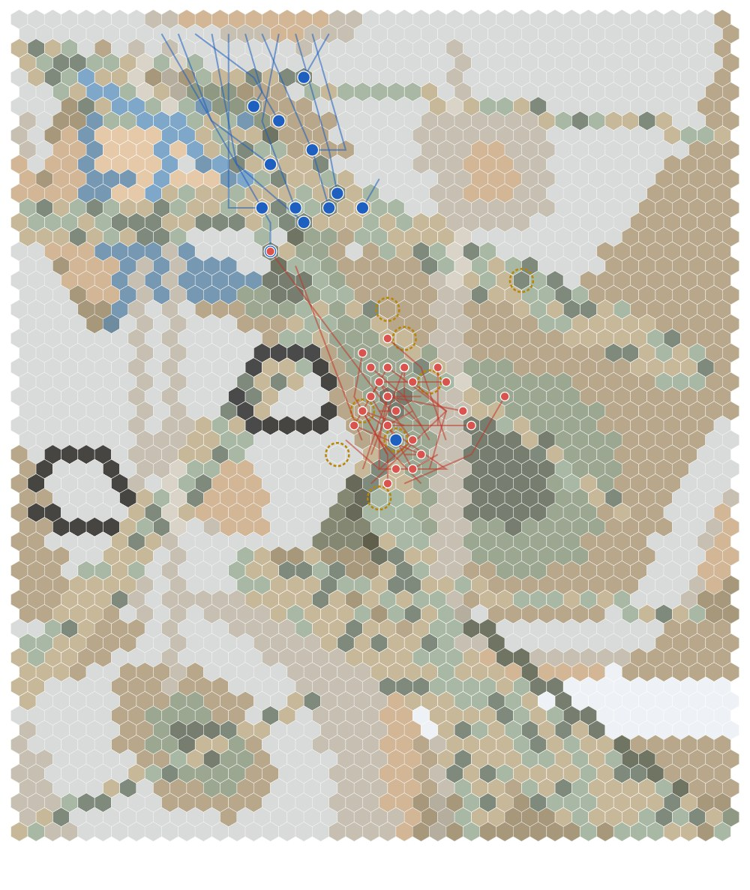

*Written by Claude from the post-battle analyses of four games the owner played between October 31 and the early hours of November 1. The owner keeps the right to edit it. The closing thoughts are the owner's.*

Four battles on the same piece of Ganymede, in about twelve hours, and all with P4.6's new fire support in play. Before each one, the game's forecast gave the EDF less than a 4% chance of winning. The EDF won all four. The more interesting story is what the fire support did, and mostly didn't do, until one change and one well-timed call.

| Battle | Rounds | EDF suits lost | Choir suits destroyed | Fire support's share of EDF damage |
|---|---|---|---|---|
| Breakthrough | 14 | 2 of 11 | 30 | 0% |
| Sweep and clear | 10 | 1 of 13 | 24 | 2.6% |
| Assault | 6 | 0 of 12 | 30, and a guard emplacement | **22.7%** |
| Capture | 6 | 0 of 13 | 24 | 7.6% |

### Who calls the fire

Fire support in MBAT comes from off the board: airstrikes from the **Strix**, a close air support exofighter, and orbital strikes from ships overhead. Only one Frame can call them: the FAASOC (Forward Artillery, Air, Space and Orbital Controller). A call isn't instant. Air strikes arrive after a delay, and orbital strikes after a lag. In the first two battles, that was two rounds for an airstrike or an orbital missile, and one for the orbital cannon.

### Battle one: the breakthrough

The EDF had to push through and out the far edge. It never got there.

Six heavy Choir suits — three element leaders and three Lictors — never advanced. They knelt at or near their own edge, which was exactly where the EDF needed to go, and fired at 23 to 31 hexes. They hit 90% of their shots, dealt 47% of the Choir's damage into EDF suits, and put all 725 points that got past the Rifleman's shield into it. The Rifleman died in round 12.

The FAASOC that day was the Herald. It called one strafing run in round 4 and died in round 5, before the strike arrived. When the Strix flew in on round 6, seven Choir suits shot at it, destroyed its right wing, and it aborted. The run landed exactly on its hex and hit nobody. With the only caller dead, the three orbital strikes on offer went unused.

### Battle two: the sweep

This time the caller was the Sentinel, a tougher FAASOC Frame. It drew fire, lived, and made four calls. Those four calls did 144 damage and killed one Choir suit.

Accuracy wasn't the problem: six of its seven landings came down on their aim. The analysis found the problem was the clock. Every call was aimed at Choir suits the EDF line was already fighting. Across the first two battles, 13 Choir suits stood near the aim points when the calls went in. The EDF's own suits killed 11 of them before the strikes landed, one or two rounds later, and the other two walked away. Had every strike landed the moment it was called, the footprints would have held 14 Choir suits between them.

One strike did matter without hitting anything: a missile warhead that landed on empty ground still made a whole Choir element spread out and hold its assault suits back for two rounds.

### The change

After the sweep, the owner cut every air delay and every orbital lag on Ganymede to one round, as a test.

### Battle three: the assault

*The assault at round 2, as the analysis drew it. EDF suits in blue, coming down from the north edge. The Choir in red, packed round the site they were defending. The gold rings are the missile volley's aim points.*

In round 1, before either side was in contact, the Sentinel lased the Choir's defended site and called a missile volley: four warheads. The defending element held its ground on the site for two rounds, as defenders do. When the volley landed at the end of round 2, 14 Choir suits were inside its footprint.

That one strike did 1,049 damage and killed nine targets, including the guard emplacement. It was 86% of everything the fire support did that game, and on its own nearly a fifth of all the EDF's damage. The battle was over in six rounds with no EDF suit lost.

It wasn't free. The Choir hunts the suits that call fire. The Sentinel drew 20 shots, 12 of them in round 1 while it held still to lase, and finished the game with 483 damage taken. The Strix drew 21 shots over two passes and aborted with its right engine destroyed.

### Battle four: the capture

The fourth game was a fast, close fight: the median range was six hexes. The Sentinel called the missile volley in round 3, after contact. By then the EDF line had already thinned and scattered the target. The volley landed on three suits at the edge of its footprint and killed none of them. A strafing run hit five suits for 181 damage, and killed none of them either. A strafing run is a light weapon.

The EDF still lost no suits. But six of its 13 shields were knocked down to zero by round 3, because the EDF fought standing in the open against a Choir kneeling in heavy cover.

### What the four battles add up to

- **Fire support kills what holds still.** The one big hit came on a defended position before contact. Once the line is engaged, the line's own rifles kill the targets faster than any strike can arrive.
- **A shorter delay helps, but only against a target that stays put.** In two strikes across the games, a one-round lag would have caught Choir suits that the two-round lag missed. Against suits already fighting the EDF line, even one round is too long.
- **An airframe's turnaround undoes the shorter delay.** A second call on the same Strix sortie waits for its next pass. The cluster bomb in the assault, called in round 3, landed at the end of round 5.
- **The Choir goes after the caller and the aircraft.** The Sentinel drew 20 shots in the assault. Two of the four Strix sorties ended in an abort, one with a wing destroyed and one with an engine.
- **The forecast needs work.** It gave the EDF a 0.1% to 3.9% chance in all four games. The EDF won all four.

### Closing thoughts

*Written by the owner*

These four games were me actually learning to play the FAASOC myself; I wrote the design brief that made it, I wrote the lag times and ideated the munitions the FAASOC can call and how the Choir should react to it on the battlefield.

None of that tells you how the thing actually **plays**, though. 

The Choir are a highly mobile force, most of whom will continue to advance even into fire. Others will try to flank the player. But no matter what, they prioritize their targets; the FAASOC sits just behind the Command Frame in priority for the Choir's targeting. In the first game I was a little overconfident; I thought the Combat Frames advancing with Active radar and firing their cannons would be enough to draw fire. Obviously, that was incorrect; the FAASOC is the Choir's primary target on the field.

The second thing I realized was how much the other Frames matter: several of them had IR Strobe launchers, which is an item that allows the FAASOC to land its airstrikes without much deviation. Advancing with the rest of the squadron and putting strobes out in likely axes of approach and then calling down fire support when the enemy reveals itself is a real tactic used in the infantry today. The fact that it works in-game tells me what I most want to know: real-world tactics enhance the gameplay experience.

In addition to these pieces, there were a lot of other things we were testing this evening: a recent shield re-dial, a melee damage re-dial (on the Choir), a driver change (on the Choir, reaction to drones). I played four games tonight, taking anywhere from twenty minutes to an hour per battle, which is exactly the length I'm aiming for.

All in all, testing went very well. I have a list of potential changes for tomorrow for some A/B testing, and I want to switch back to the old orbital rules. I also realized I forgot to include a shield on the Strix, which explains why it was forced to abort in multiple missions this evening. Shields provide a lot of sustain.

Good round of testing, hopefully another four to six games tomorrow with some automated testing by Claude to look for edge cases.