This is the first look at MBAT's terrain art: the board from tonight's Capture mission, drawn in the new isometric view. At the end is the full analysis of the battle played on it.

A few days ago I wrote about the end of P4.6: it met its acceptance criteria for close. I've had the art pipeline in development since about the beginning of October, focused on early versions of the art, the art-picking algorithms and stamp creation. P4.6 is a stable platform, so it seemed a good place to put this in. There are still two phases left in P4, and their chunk-close rituals will give the isometric view extended testing.

The other thing I wanted to do was showcase what my actual mission analysis really looked like, which you'll find at the end. 

### The board

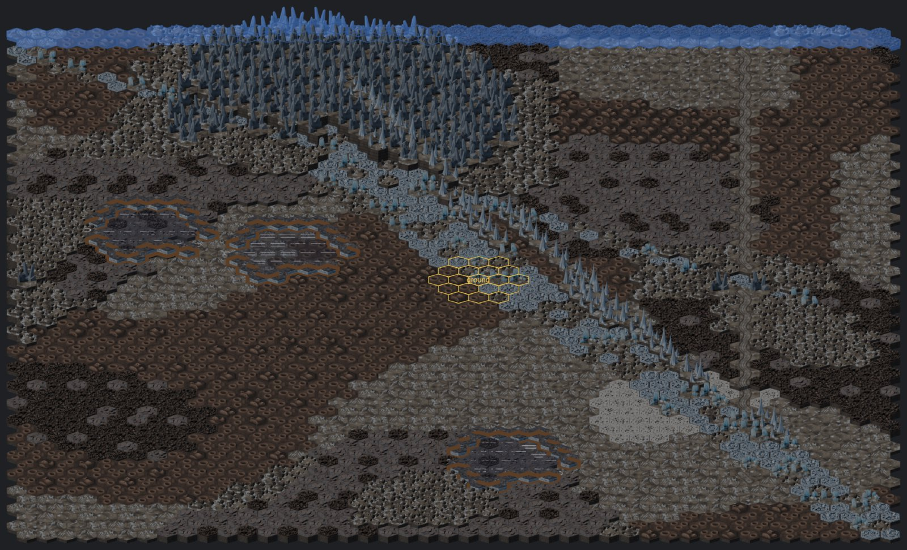

*The whole board: 44 by 58 hexes on Ganymede, during an eclipse. The EDF came in from the top edge. The objective is the zone outlined in gold, marked "ground," at the center.*

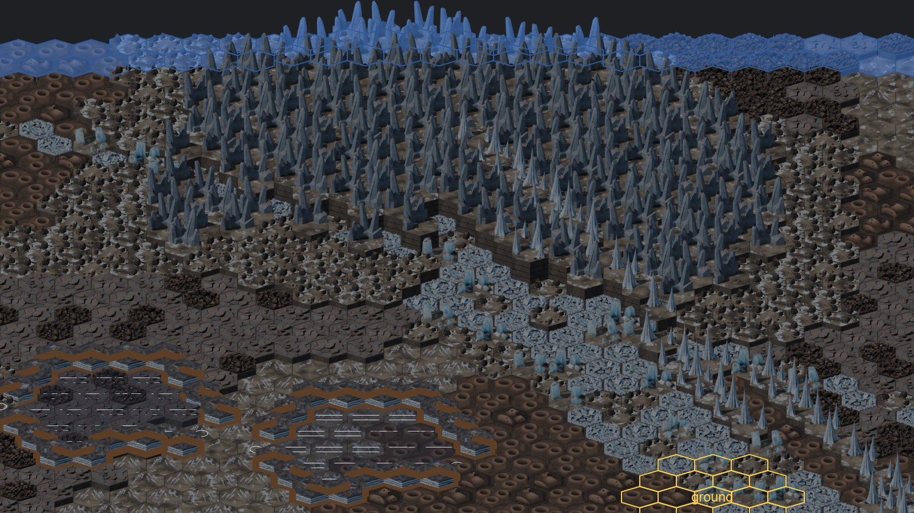

*The height along the EDF's edge, covered in ice spires. It's heavy obstruction, two to four levels up, and it's where I set my base of fire all game.*

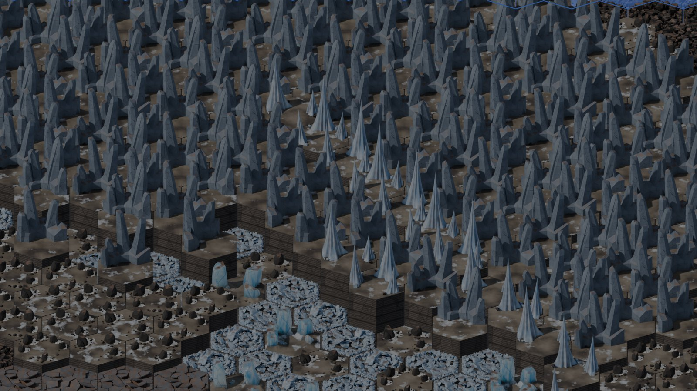

*The summit, up close. The cliff strips show where the ground steps up a level.*

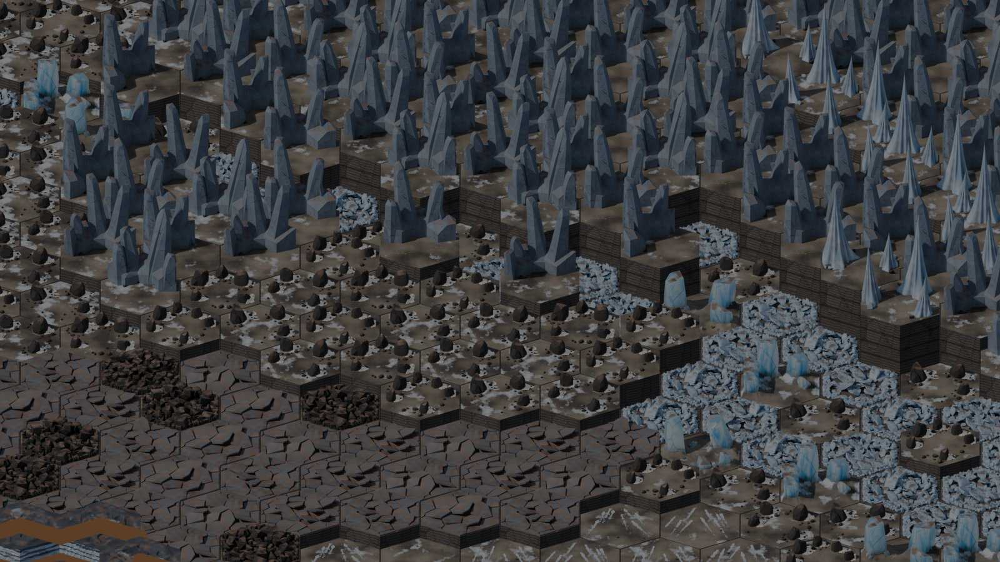

*The height's south edge, where it drops to the rough ground and light obstruction that formed the EDF's approach.*

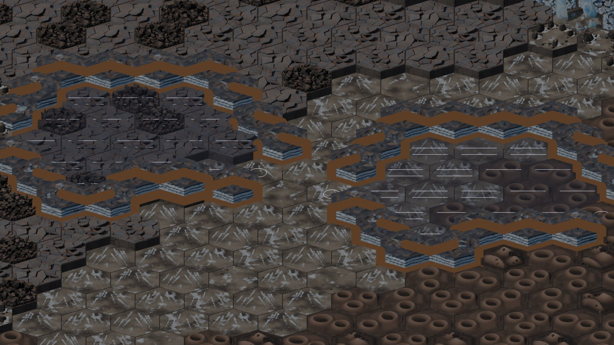

*Cave walls west of the zone.*

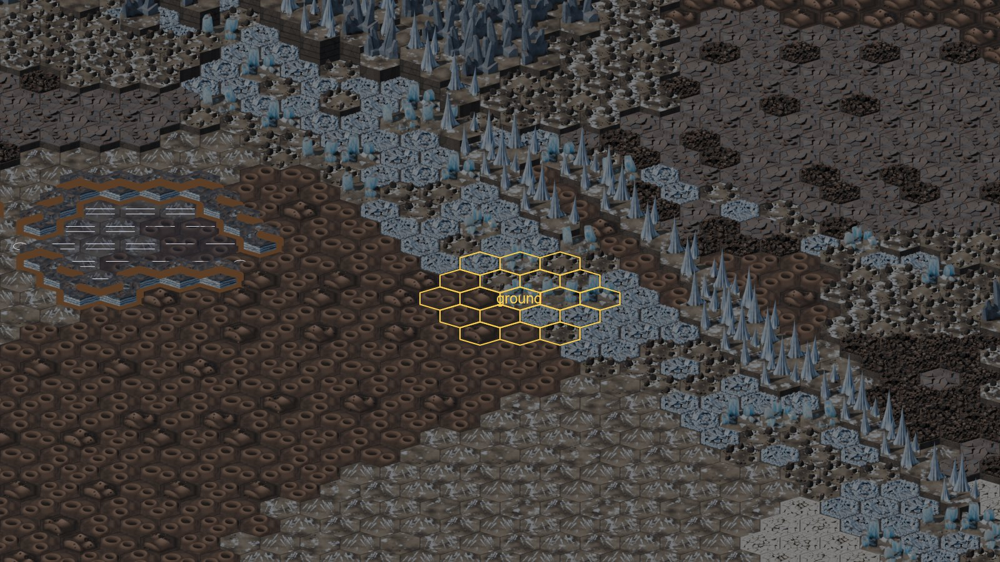

*The zone, and the spine of heavy obstruction running down its east side.*

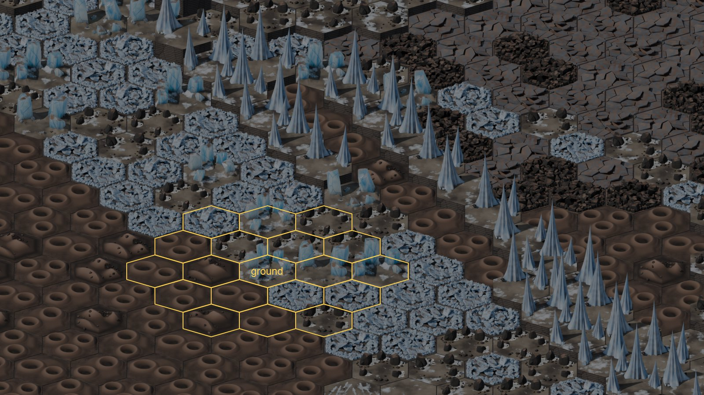

*The east spine, up close, beside the zone.*

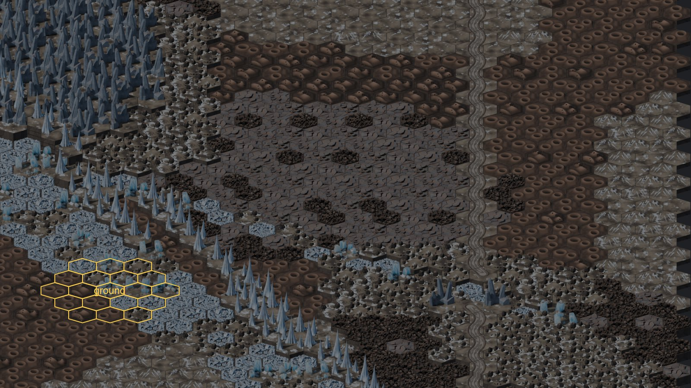

*The graded road on the east flank.*

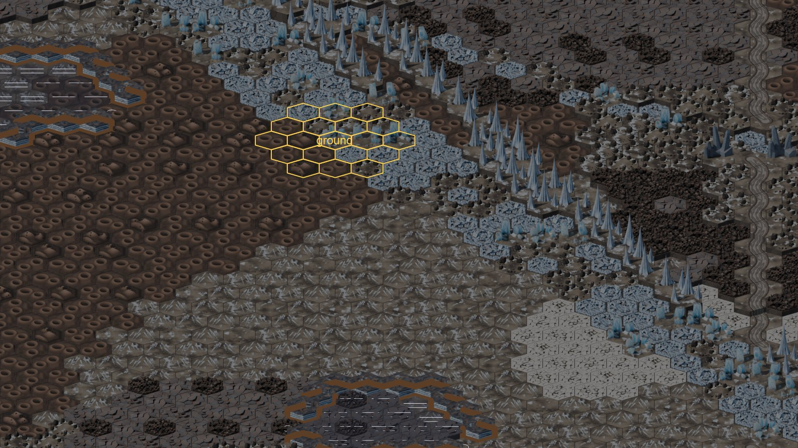

*The open ground south of the zone, behind the Choir's position. One EDF suit died out there.*

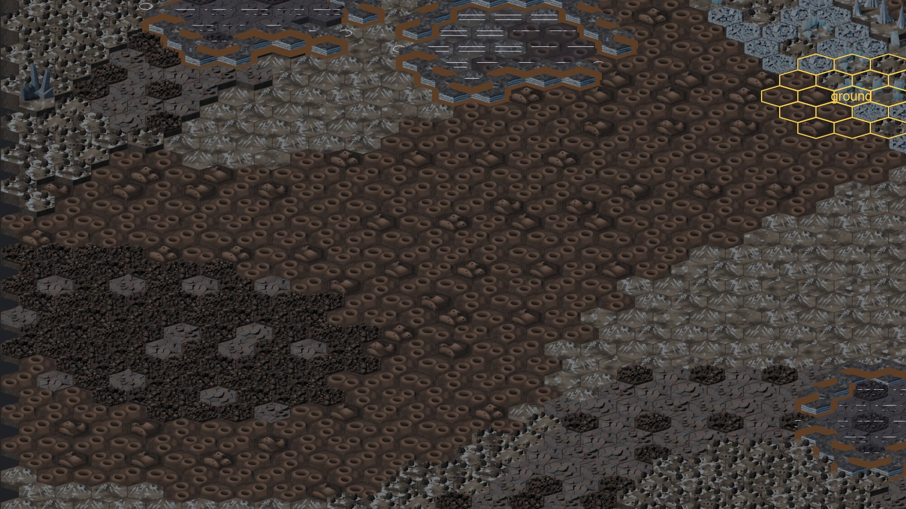

*Crater ground to the southwest.*

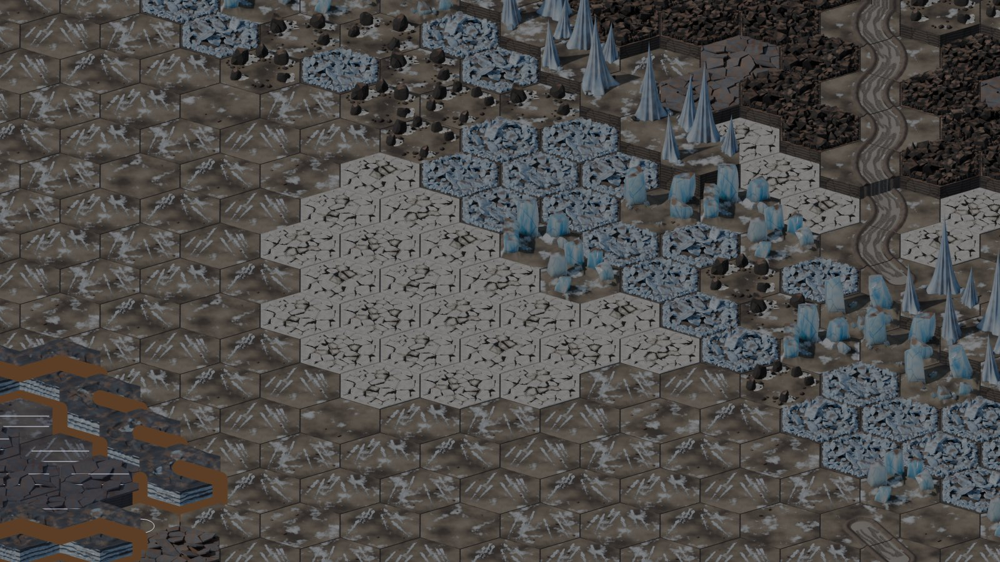

*The salt flat.*

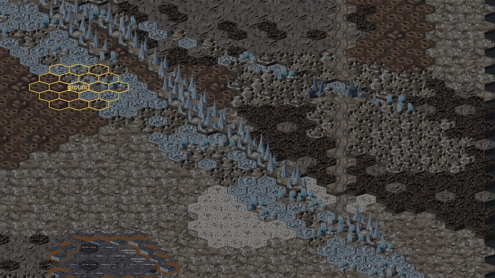

*The southeast rise.*

### Closing Thoughts

P4.6 is a stable version that's had around 200 defects fixed within it. It plays clean, but I'm still finding new defects almost every day, just none that are game-breaking or that affect play much. I've decided to 'pause' here for a moment and test out the art pipeline and work through bugs in its code, and there are some large ones that were easily disguised in the vector art view that I was using previously.

Speaking of which, that vector view hasn't gone away. MBAT allows a person to fully turn off the isometric view and the art and switch back to the vector-based, top-down view at any time simply by using a keyboard shortcut.

This is an early, rough draft of where I'd eventually like to take the art. There are a lot of things wrong here - the kind picker (which asset file is selected) is working how I want it to, but there's a large bug in the 'stamp' placement where ~50% of placed terrain can be Rough Terrain and some terrain kinds are *never* placed. When you're using vectors (literally, images drawn from math, not via any 2D or 3D modeling tool), that's hard to detect. 

You can see another problem in the screenshots: there's a uniformity-breaking rule that fires on a frequency basis, which helps to break up the outline of a large 'blob' of terrain but also creates regular patterned rows. It's a known issue, and the fix is simple: give the algorithm some variance and allow any one of those uniformity breaking fires to generate its own 'stamp', which will create a more integrated look to the terrain without significantly altering the terrain generation pipeline.

The next stop is actually P4.6t1 and P4.6t2, which will change how 'stamp' generation works. A stamp is a major terrain piece, like a crevasse, a slush river, stuff like that. The original idea for the stamp method was a proof-of-concept build that only used a few. P4.6t1 and t2 will significantly expand the stamp set to create things like ringed craters of varying sizes, massifs, slush rivers that actually follow the low ground, embankments, gullies, natural trenches, ejecta rays, and a few others.

Again, all in service of making a player feel like they're actually playing on Ganymede. Stamps are code pieces that change per-planet, so the intent is to make every planet's terrain somewhat unique based on its properties as well as its art.

### The Played Analysis

This is the actual analysis, warts and all, that I see after every mission, whether I play it, Claude plays it, or the integrated Lance Driver AI plays it (the game's NPC AI).

#### P4.6a2 played: gan-0247 Capture (3:0), the owner's decisive win, 23 of 24 in 8 rounds, the Raider lost (2026-11-13)

*Played by the owner, EDF side, on 2026-11-13 (the record saved at
20:10). The record replays to its digest on `ebc9a47d` (rules 0.28.3).
Read in the order of `PLAY_TACTICS_GUIDE.md` §8: the ground, each side's
intent, who drew the fire, then the numbers. The intent in §4 is read
from the moves; the owner's own account is not in the record. Hexes are
the log's (q,r); a row is r.*

#### 1. Result

| | |
|---|---|
| Mission | `gan-0247:c0:capture:3:0`, Capture on a secondary crater chain; **eclipse**, dust fall, thin atmosphere, gravity × 1.5; 44 × 58; the Dark Lag cave, 51 roofed hexes |
| Objective | Take the zone `ground` (rows 26–30), set a charge, hold 6; the Choir's, annihilate the EDF. No clock |
| Drop | 11 suits: Khan (Verdict, commander), Juggernaut (Switch), Rifleman ×2 (Demon, Chevy), Talus (Hotfoot), Raider (Hex), Vesper (Lantern), Bastion (Bunker), and three that were not in the 2:0 drop: **Sparrow (Gramps), Paladin (Pockets), Warhammer (Wrongway)**. Air denied, orbital denied |
| The Choir | 24 units: a Legate, two Evocatus Exemplars (Returned pilots), a Praetorian, a Hoplite, two Centurions, three Lictors, four Legionnaire Primus, two Legionnaires, four Soldiers, three Stalkers, a Bloodhound |
| Result | **A decisive win. The Talus set the charge at (9,26) in round 6 and it held 6 of 6; the game ended in round 11.** 23 of 24 Choir units destroyed by round 8. **One EDF suit lost: the Raider, round 5; its pilot, Hex, injured.** The Warhammer lost its right arm; the Khan lost its sensor suite to a critical |
| The auto-resolver's bands | disaster 29.95 %, defeat 35.05 %, marginal loss 17.05 %, draw 13.05 %, marginal win 4.55 %, decisive 0.35 %, rout 0 % |

#### 2. The ground

| Feature | What it did |
|---|---|
| A heavy-obstruction height, columns 9–24, rows 1–14, elevation 2–4 | The EDF edge was on it. The Juggernaut, the Bastion, the Paladin and the Sparrow fired from it or from its south slope for the whole game; the Khan for rounds 1–3 |
| Light obstruction and rough ground, rows 12–19, below the height | The approach. The forward group's hexes in rounds 1–3 |
| The zone, rows 26–30: clear and drift in the center, the cave's walls on its west and north (columns 4–16, rows 20–27), a heavy-obstruction spine on its east (from column 21, row 20 to column 29, row 31) | The Choir's ground. 10 of its 23 dead fell on drift (cover 0), 5 on rough ground, 8 in light or heavy obstruction |
| A clear lane, columns 27–38, rows 1–8, then drift and rough ground east of the spine to row 36 | The east flank. The Raider went down it alone |
| Clear ground south of the zone, rows 31–37 | Behind the Choir. The Raider died on it |

Not the range of the 2:0 game. The height hid the EDF's fire base: the
Choir's fire had a median range of 5 hexes, and it found targets only
where the EDF went forward.

#### 3. What happened

| Round | Choir lost | The EDF | The Choir |
|---|---|---|---|
| 1 | 0 | The fire base stayed on the height (rows 1–5); the Khan jammed. Six suits went forward 8–13 rows: the Riflemen and the Talus to rows 9–11, the Raider to (25,12), the Warhammer and the Vesper to row 14. **The Sparrow put two Recon Drones over the zone's north edge and a sensor grenade's eye on (10,23).** 0 locks of 3. 40 shot lines, 39 of them chaingun bursts at 5 % and 12 % (2 hits) | An Exemplar came out to (17,25) and fired 6 Onager shots at Chevy's Rifleman: 138, knocked down. A Stalker ran 13 rows into the Raider's hex. Six suits jammed |
| 2 | 3 | Kills: the Stalker in the Raider's hex (the Juggernaut's MLRS), the Exemplar (Chevy's railgun), a second Stalker that closed on the Warhammer (its chaingun). The Raider went east to (26,20), prone. The Sparrow launched two Inferno Drones | 4 shot lines |
| 3 | 0 | **The Warhammer entered (11,26), in the zone, through four overwatch shots. Chevy's Rifleman entered (11,22) through one.** Both were knocked down. An Inferno Drone lit and burned (7,28). 52 missiles: 29 intercepted, 5 hit. 3 locks of 8 | 5 overwatch shots. The second Exemplar took the Warhammer's right arm (two Solitaire hits at 95 %). A Soldier closed on the Warhammer, the Praetorian on Chevy |
| 4 | 2 | Kills: the second Exemplar (the Paladin's HE), the Soldier that had closed on the Warhammer (a Kinetic Kill Drone). **The Warhammer went back 11 rows to (16,15) and stayed there to the end.** The Raider entered (13,31), south of the zone, through a Centurion's overwatch. The Khan came forward to (12,15). **0 locks of 8**; 46 missiles, 2 hit | 34 shot lines, its most. 15 at the Warhammer, 9 at Chevy's Rifleman (274; knocked down again) |
| 5 | 4 | **The ECM on each lock fell from 56.25 to 18.75.** 5 locks of 10; 34 missiles, 13 hit. Kills: the Hoplite (the Raider, after it closed on it), a Centurion (the Juggernaut), a Legionnaire Primus (the Khan), a Lictor (an Inferno Drone's fire, at the round's end). **The Raider, at (8,34) on a clear hex, was destroyed:** a Lictor's two Hasta hits in the reactor, a Stalker's Talons, a Legionnaire Primus's Ballista in the torso | 28 shot lines; 10 at the Raider, 11 at Demon's Rifleman (254) |
| 6 | 5 | **The Talus entered the zone and set the charge at (9,26).** Kills: the Praetorian, a Centurion, a Legionnaire Primus (heavy MLRS), a Lictor (a Rifleman's high-velocity cannon), a Lictor (two Kinetic Kill Drones, then the Paladin's Precision round) | 8 shot lines |
| 7 | 4 | Chevy's Rifleman and the Talus each closed into a Soldier's hex. Kills: the Legate (the Juggernaut's micro-missiles, head), a Legionnaire Primus, two Soldiers (one to a Kinetic Kill Drone) | The Legate fired 11 shots at a Kinetic Kill Drone and hit none. A Stalker closed on the Khan, the Bloodhound on Demon's Rifleman |
| 8 | 5 | 5 locks of 5. Kills: the Stalker, the Bloodhound, a Legionnaire Primus, two Legionnaires (one to the last Kinetic Kill Drone) | 2 shot lines. One Soldier left |
| 9–11 | 0 | Pings, overwatch, one illumination round on the zone. No contact made | The Soldier stayed Passive: (9,28), then (12,25), then (10,24). It was not found. The charge's sixth round ended the game |

Kills by round: 0, 3, 0, 2, 4, 5, 4, 5.

#### 4. As a commander

| What | The record |
|---|---|
| **The fight had two halves, and the jamming was the hinge.** Rounds 1–4: 5 Choir dead. Rounds 5–8: 18 | Rounds 1–4: 26 of 27 EDF locks paid an ECM of 56.25; 7 held; 138 missiles, 12 hit. Rounds 5–8: every lock paid 18.75 or less; 15 of 25 held; 136 missiles, 42 hit |
| **The suits that went into the zone in round 3 took the Choir's fire for no kill there.** The Warhammer and Chevy's Rifleman entered hexes the Choir had on overwatch, with no lock on the line and the missiles not yet hitting | The Warhammer: 28 shot lines, 586.1 taken, 257.6 past the shield, an arm lost, 90.1 dealt. Chevy's Rifleman: 20 shot lines, 521.6, 0 past the shield |
| **The Raider went around alone and was the one loss.** Rows 12, 20, 25, 31, 34 by round: east of the spine, then behind the zone, 19 Choir units alive when it arrived | It killed the Hoplite. The nearest EDF suit was 10 hexes away when it died. Six Choir units attacked it in round 5 (10 lines); the kill came from two reactor hits at +50 %, then a torso hit |
| **The fire base on the height was not shot at.** The Juggernaut, the Bastion, the Paladin and the Sparrow took 0; the Khan took 98, all on its shield, after it went forward | Those five suits made 18 of the 23 kills and 3,851 of the 6,571 damage. The Paladin did not move from row 1: 3 MLRS volleys on locks at 21–31 hexes, HE and Precision rounds, 732.8, 2 kills |
| **The Khan in heavy obstruction on the height drew no shot in rounds 1–3**, and 8 shot lines after it went forward. In the 2:0 game, prone on a clear hex at row 2, it drew 27 and was the most-damaged suit | 98.0 taken against 682.5. It jammed in both games |
| **The Sparrow paid for its drop slot from row 5 to row 14, Passive.** 9 drones, a sensor grenade and 5 HE grenades | 4 kills (three by Kinetic Kill Drones, one by an Inferno Drone's fire); 880.0 damage with its drones. Its Recon Drones and its sensor grenade's eye made 6 of the EDF's 8 detections. Five Kinetic Kill strikes at 128 each: three finished a unit, two stripped a Lictor for the Paladin's round |
| **The Vesper was the forward eye again, and the jamming beat it for three rounds.** Prone and Passive at rows 14, 17, 19, 22, 26 | 3 locks of 7: three failures at 34 % under 56.25, then 3 of 4 at 71 %. No Choir shot was aimed at it; it took 0 |
| **The Choir held its ground this time.** It did not walk onto the open ground in front of the EDF, as its center group did in the 2:0 game | Its overwatch fired 9 times, all in rounds 3 and 4, all at suits entering hexes in or beside the zone. Its melee units still came singly: 7 closes; six of the seven units were dead by the end of the next round (the Praetorian lived three more) |
| **The last Soldier outlived the search.** Three rounds of pings and overwatch from 10 suits | It ended 2 hexes from the charge. The EDF's contact list at the end held one Suspected hex |

#### 5. The numbers

| Counter | EDF | Choir |
|---|---|---|
| Direct-fire and missile hit lines / rolls | 125 / 222 | 49 / 86 (57 %), mean chance 62.6 % |
| Melee rolls / hits | 1 / 0 | 33 / 24 |
| Missiles: volleys / missiles / intercepted / hit | 52 / 274 / 113 (41 %) / 54 (20 %) | 0 |
| Locks tried / made | 52 / 22 | 13 / 8 |
| Jam starts; pings | 1; 18 | 18; 1 |
| Range, median | 9 | 5 |
| Firer's stance | standing 185, kneeling 33, prone 4 | kneeling 76, standing 10 |
| Firer's hex | heavy obstruction 103, light 57, drift 35, rough 17, clear 10 | heavy obstruction 41, drift 23, rough 17, light 5 |
| Damage dealt / past shield | 6,570.7 / 4,620.2 | 2,457.4 / 393.1 |
| Shields returned | 1,874.3 (recharge 1,259.3; 12 Boosts, 615) | 289 |
| Bubble Shields and Aegis took for others | -- | 315.0 and 85.0 |

| Suit | Damage dealt | Kills | Damage taken | Past shield |
|---|---|---|---|---|
| Juggernaut | **1,043.8** | **6** | 0 | 0 |
| Rifleman (Chevy) | 920.2 | 3 | 521.6 | 0 |
| Rifleman (Demon) | 881.0 | 0 | 454.6 | 0 |
| Sparrow, with its drones | 880.0 | 4 | 0 | 0 |
| Khan | 803.0 | 4 | 98.0 | 0 |
| Paladin | 732.8 | 2 | 0 | 0 |
| Bastion | 391.8 | 2 | 0 | 0 |
| Raider (lost) | 215.0 | 1 | 379.0 | 105.0 |
| Talus | 207.0 | 0 | 418.0 | 30.5 |
| Vesper | 102.0 | 0 | 0 | 0 |
| Warhammer | 90.1 | 1 | **586.1** | **257.6** |

| Weapon | Kills | Damage to the Choir |
|---|---|---|
| Heavy MLRS (AP) | 8 | 1,375.8 |
| Micro-Missile Pod (AP) | 4 | 596.0 |
| M-77 Railgun | 3 | 711.0 (15 rolls, 13 hits) |
| Kinetic Kill Drone | 3 | 640.0 (5 strikes) |
| GBU-75 High-Velocity Cannon | 1 | 618.0 (10 rolls, 7 hits) |
| M-113 UV Laser Rifle | 0 | 614.8 (18 rolls, 13 hits) |
| GBU-19 Chaingun | 1 | 477.6 (116 burst rolls at a mean 32 %, 29 hits) |
| Precision round (the Paladin, the Bastion) | 1 | 474.0 (4 rounds, 4 hits at 94 %) |
| Howitzer HE and grenade HE | 1 | 523.2 |
| Inferno Drone and its fire | 1 | 254.4 |
| Light MLRS (AP) | 0 | 184.0 |
| M-14 Marksman Rifle | 0 | 102.0 (5 rolls, 5 hits) |

Missiles made 12 of the 23 kills. The Juggernaut fired 122 of the 274
and lost 53 to point defense; the Khan fired 78 and lost 34.

| Rounds | ECM on an EDF lock | Locks made / tried | Missiles fired / intercepted / hit |
|---|---|---|---|
| 1–4 | 56.25 on 26 of 27 | 7 / 27 | 138 / 71 / 12 |
| 5–8 | 18.75 on 24 of 25; 0 on 1 | 15 / 25 | 136 / 42 / 42 |

#### 6. Against this morning's game

| | Capture 2:0 (11:12) | This game |
|---|---|---|
| Odds | 9 v 24 | 11 v 24 |
| Off-board fire; drones | none; none | none; 9 (2 Recon, 2 Inferno, 5 Kinetic Kill) |
| Ground; sky | An open plain; day | A height over a walled zone; eclipse |
| Rounds to the last kill; to the end | 6; 6 | 8; 11 |
| Choir destroyed / EDF lost | 24 of 24 / 0 | 23 of 24 / 1 |
| Choir attacks (ranged and melee) | 128 | 119 |
| Damage into EDF suits / past shield | 2,968.5 / 745.0 | 2,457.4 / 393.1 |
| EDF locks made / tried | 21 / 34 | 22 / 52 |
| Missiles hit / fired | 57 / 218 (26 %) | 54 / 274 (20 %) |
| Fire, median range: EDF / Choir | 9 / 11 | 9 / 5 |
| The forecast: any win | 1.8 % | 4.9 % (defeat or disaster 65.0 %) |

#### 7. Findings

| Finding | Measure |
|---|---|
| The forecast missed a fourth time, in the same direction | Any win 4.9 %, decisive 0.35 %; played decisive, 23 of 24 for one suit |
| Three overlapping jammers stopped the missile game for four rounds | 56.25 on 26 of 27 locks; 7 held; 12 of 138 missiles hit. The best lockers read 34 % (the Khan, the Vesper) |
| The two entries into the zone before the jamming fell cost the most and returned the least | The Warhammer and Chevy's Rifleman: 926 taken in rounds 3 and 4, of the EDF's 2,457.4 for the game |
| A lone flanker behind the Choir with 19 alive was the loss | The Raider: 10 attack lines in round 5, the nearest friendly suit 10 hexes away. In the 2:0 game the same suit made the same move with 4 alive and took 75 |
| The commander in heavy obstruction on a height was left alone | The Khan: 8 shot lines and 98.0, against 27 and 682.5 on a clear hex |
| The Sparrow worked as a drone controller on its first drop | 4 kills, 880.0, 6 of 8 detections, 0 taken; it ended 12 rows behind the zone |
| A Kinetic Kill Drone drew a commander's whole activation | The Legate: 11 shots at a drone, 0 hits, round 7; it died that round |
| The Choir's overwatch covered the zone's edge and fired only at entries | 9 overwatch shots, rounds 3–4; 26 Overwatch commands in the game |
| The targeting computer lost this morning was back | Chevy's Rifleman read +10 for it on every lock from round 2 |
| Criticals took two sensor suites | The Khan's sensor suite 3, offline, round 5 (a Centurion's Onager, head, 65 %, rolled 7); the Warhammer's, a glitch for round 4. 26 of the Choir's 73 hits were at +50 % |

#### 8. Defects

The record shows none: no refusal, no own-side hit. Two items:

| Item | State |
|---|---|
| The replay's *"repulse ... N hostile unit(s) still acting"* line, left open in the 2:0 analysis | Closed. It is the Choir's annihilate objective counting live EDF suits (10 here, 9 there); it is not a count of Choir units |
| A live Choir Soldier stood 2 hexes from the charge at (9,26), inside the objective's radius of 2, in the hold's last round, and the hold counted | Closed: as ruled. TR §4.9's Hold row asks only that *"at least one **acting** unit of that team stood within `radius` of the planted hex"* at each round end; a hostile unit in the radius is not read. `Mission._tick_holds` (`mbat/mission.py:5347`) does the same. The Talus lay on (9,26) from round 6 to the end; the log has no *"is given up"* line |

#### 9. Files

| File | What |
|---|---|
| `records/gan-0247-c0-capture-3-0_…_5d4b00eb.json` | The record (untracked, as every record) |
| `docs/handoffs/P4.6_WORKING/play_kit/` | `replay.py`, `tactics.py`, `extra.py` |
| The session's scratchpad | `maps.py`, `tally.py`, `locks.py` (each lock itemized), `more.py` (locks and missiles by round, the Sparrow's lines, where each unit died) |
